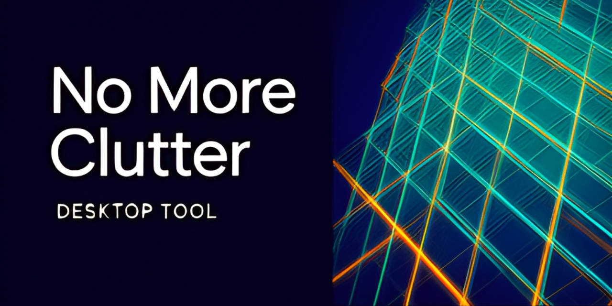
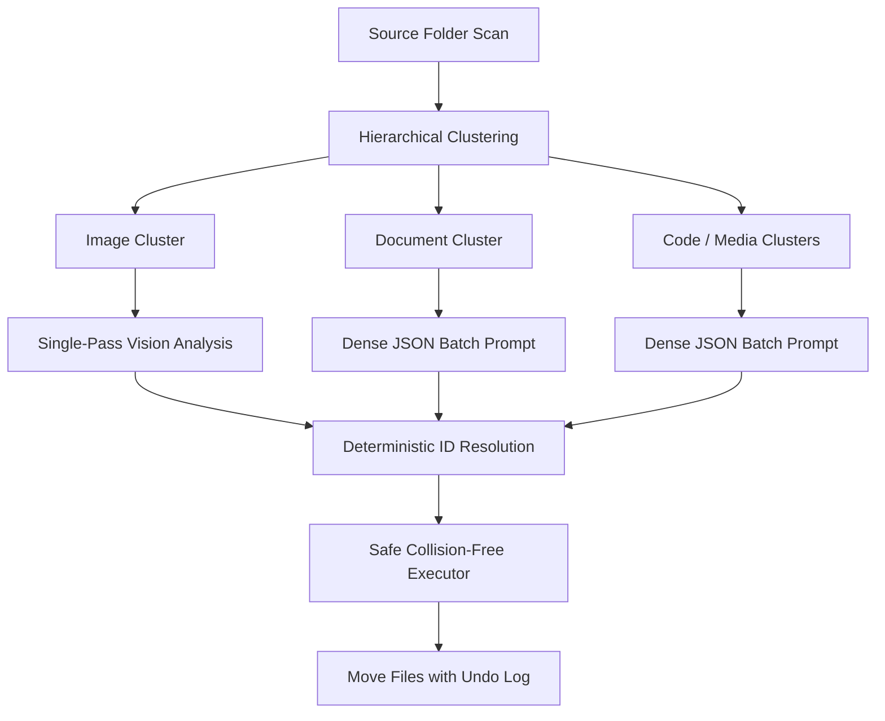

# NoMoreClutter 🗂️✨

<!-- aegean:media:start -->
<p align="center"></p>
<p align="center"><a href="LICENSE"></a> <a href="https://github.com/AegeanWorks/AIKit"></a></p>
<!-- aegean:media:end -->


An intelligent AI-powered desktop application that automatically organizes your files using Large Language Models (LLMs). Say goodbye to cluttered folders and let AI analyze, categorize, and rename your files with smart descriptive names!

## ⚡ 30-Second Cold-Start Quick Reference

- **Runtime Prerequisites**: Python 3.10+ (CustomTkinter, Pillow; local LLM or API keys).
- **Canonical Regression Shield Gate**:
  ```bash
  python -m unittest discover tests
  ```
  The default suite is headless. Interactive dogfood tests that mount the live UI are opt-in:
  `NOMORECLUTTER_GUI_TESTS=1 python -m unittest tests.test_dogfood`.

### 🛠️ AIKit Commands (run from the AIKit folder)
| Role | Command |
|---|---|
| Status, task and gates | `python aikit.py status nomoreclutter` |
| Phase 4: every gate | `python aikit.py check nomoreclutter` |
| Repair memory and map, then check | `python aikit.py fix nomoreclutter` |
| Resume an interrupted task | `python aikit.py resume nomoreclutter` |

## 📦 What's Inside

```text
nomoreclutter/
├── .aikit/                   <- this project's memory: record, ledger, decisions
├── .gitignore                <- transient AIKit state excluded
├── README.md                 <- cold-start reference and documentation
├── assets/
├── COMMERCIAL.md
├── LICENSE
├── LICENSES/                 <- REUSE license texts
├── REUSE.toml                <- Machine-readable SPDX metadata
├── requirements.txt          <- dependencies
├── main.py                   <- desktop application entrypoint
├── models/                   <- data models
├── scripts/                  <- application test and dogfood harness
├── services/                 <- AI providers, RLM organizer, file executor
├── tests/                    <- unit and integration test suite
└── ui/                       <- CustomTkinter desktop interface
```

---

## 🎯 Key Features

### 🚀 1-Click AI Quick-Deploy
- **Standalone Official Local Engine (`llama-server.exe`)**: One-click download of the official precompiled portable binary directly from `ggml-org/llama.cpp` releases. Zero Python C++ compilation dependencies, high-speed AVX2 CPU optimization, and multimodal vision projector support.
- **Embedded Local GGUF Weights**: Single-click streaming download of compact quantized models (`Qwen 2.5 1.5B`, `Moondream 2 Vision`, `Qwen 2.5 0.5B`, `SmolLM2 1.7B`) from HuggingFace with progress tracking and atomic caching.
- **1-Click Ollama Auto-Pilot**: Automatically connects to your local Ollama daemon on `localhost:11434`, pulls recommended models (`llama3.2:1b`, `qwen2.5:1.5b`), and tracks download progress.
- **1-Click Free Cloud Connect**: Direct setup and instant connection verification for Groq and Google Gemini free tiers.

### 🧠 Recursive Language Model (RLM) Organization
- **Hierarchical Clustering**: Files are grouped into logical clusters before prompting, preventing token exhaustion and staying well within free-tier rate limits.
- **Intelligent Document Peeking**: Extracts compact snippets ($\le 200$ chars) from PDF documents, Word files (`.docx`), Markdown, and text files using standard library utilities (`zipfile`, `zlib`) with zero third-party dependencies.
- **Camera Photo Date-Grouping & Anti-Hallucination Guard**: Camera photos with numeric timestamps (e.g., `20170926_112101.jpg`) are automatically organized into chronological albums (`Photos/2017/`) without guessing scenes when Vision is not active.
- **Token Frugality (~70% Savings)**: Ultra-dense JSON payloads eliminate repetitive path dumps and reduce prompt token overhead.
- **Single-Pass Vision Analysis & Graceful Fallback**: Categorizes and renames images in a single call when vision models are present, and gracefully routes to text RLM clustering if vision is unavailable.

### 🗂️ Interactive Tree Preview & Selective Execution
- **Hierarchical Visualizer**: Replaces blind all-or-nothing moves with an expandable, interactive Tree Preview window (`TreePreviewDialog`).
- **Selective Move Execution**: Files are grouped by destination subfolders. Toggle individual files or entire folders with `[☑ Select All]` to skip files you do not want moved.
- **Live Search & Direct Native Preview**: Instant search bar auto-expands and filters matching files. Double-click any row to launch the target file directly in your operating system default application.

### 🔍 Smart Duplicate File Finder & Storage Reclaimer
- **Real-Time Progressive Streaming**: Confirmed duplicate clusters are streamed into the UI in real time as files are hashed.
- **Lag-Free Paginated Scrolling**: Paginates duplicate clusters in smooth 25-set increments (`PAGE_SIZE = 25`) with dynamic `[ ⬇️ Load Next 25 ]` and `[ ⚡ Load All ]` controls.
- **Zero-Dependency Two-Stage Hashing**: Fast file size indexing followed by 8KB header checks and 64KB chunked full SHA-256 for identical byte-for-byte matching.
- **1-Click Safety Actions**: Move duplicates safely into `_Duplicates/` with collision-safe names or permanently trash selected duplicates.

### 👁️ In-App File Viewer & Side-by-Side Comparator
- **Universal Multi-Format In-App Preview**: Preview images, text & source code files, extracted documents (PDF/Word text snippets), or binary files (512-byte hex dump).
- **Foreground Focus & Modal Grab Protection**: Dialog claims modal grab and pulses to the foreground so previews are immediately visible.
- **Side-by-Side Duplicate Inspector**: Compare canonical original files against redundant duplicate candidates side-by-side with 100% byte-for-byte verification banners.

### 🧹 Orphan Folder & Junk Pruner
- **Bottom-Up Leaf Pruning**: Recursively prunes abandoned empty directory branches from deepest leaves upward using safe `os.rmdir()`.
- **Zero-Byte File Clean**: Eliminates 0-byte leftover files and incomplete downloads.
- **OS Debris Removal**: Purges annoying Windows and macOS artifacts (`Thumbs.db`, `.DS_Store`, `desktop.ini`).

### 🛡️ File Safety & Persistent Multi-Session Undo
- **Collision Avoidance**: Never overwrites existing files; intelligently renames colliding filenames to `name (1).ext`.
- **Persistent Multi-Session Undo**: Operation history is atomically committed to `history.json`. Revert past reorganization batches across app restarts and reboots with a single click.

---

## 🚀 Getting Started

### Prerequisites
- Python 3.10 or later
- Install required packages:
  ```bash
  pip install -r requirements.txt
  ```

### Running the Application
```bash
python main.py
```

---

## 🔧 Architecture: Recursive Language Model (RLM)

Instead of dumping hundreds of raw file paths into a single LLM prompt (which blows up context windows and hits rate limits), NoMoreClutter uses a **Recursive Language Model** architecture:



1. **Hierarchical Clustering**: Files are partitioned by semantic domain and extension type.
2. **Dense Token Serialization**: Payloads use compact relative identifiers (`{"id": 0, "name": "...", "ext": "..."}`) cutting token costs by ~70%.
3. **Deterministic ID Resolution**: LLM responses are indexed by exact IDs, eliminating off-by-one mapping errors.
4. **Collision-Safe Execution**: Every move verifies destination paths and appends numbered suffixes (`file (1).ext`) if collisions exist.
5. **Undo Log**: Every executed operation is preserved in persistent history, allowing instant rollback across sessions.

---

## 🐶 Interactive Dogfooding & Chaos Verification

The repository includes a live operational dogfooding runner that directly mounts and drives the CustomTkinter window, exercising all subsystems and testing dirty LLM outputs under realistic conditions:

```bash
# Run full interactive dogfooding suite across all 12 corners
python scripts/dogfood_app.py
```

- **Zero-Blast-Radius Safety Jail**: Strictly confines all test operations to isolated ephemeral sandboxes (`%TEMP%/nmc_dogfood_*`), blocking any mutation or access to real user folders.
- **Live GUI Lifecycle & Event Pumping**: Spawns `NoMoreClutterApp`, verifies directory selection, Quick Organize, category toggling, and traps unhandled Tkinter callback exceptions.
- **Tree Preview & Multi-Session Undo**: Interactively tests per-file selection checkmarks, folder preview rendering, execution, and persistent atomic undo rollback.
- **Settings & Sliders Persistence**: Validates UI sliders and guarantees atomic persistence with buffer flushing and `fsync`.

---

## 🐛 Troubleshooting

### "Failed to connect to AI"
- **For Cloud Providers (Groq, Gemini, OpenAI)**: Make sure your API key is correctly pasted in the settings panel and you have an active internet connection.
- **For Local Servers (LM Studio, Ollama)**: Ensure your server is running and listening on the designated port (`1234` for LM Studio, `11434` for Ollama).

### "Reverting file moves"
- Simply click **↩ Undo Moves** in the UI. The app will move all files from the last executed batch back to their exact original locations.

---

<!-- aegean:brand-assets:start -->
## 🎨 Brand Assets

> **AI-Generated Brand Artwork.** The banner and logo are **AI-generated brand assets**. They are illustrative and may not literally depict every feature or the full project scope.
<!-- aegean:brand-assets:end -->

## 📜 License

Free for personal use under the Aegean License 1.1 (AL-1.1); see [LICENSE](LICENSE). Any commercial use needs the Aegean Commercial License 1.0 (ACL-1.0); see [COMMERCIAL.md](COMMERCIAL.md).
