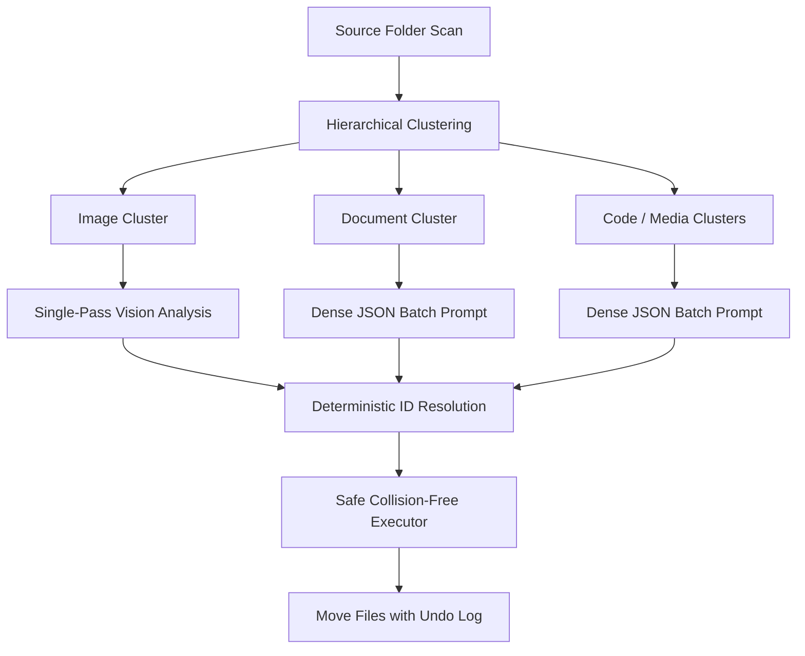

# NoMoreClutter 🗂️✨

An intelligent AI-powered desktop application that automatically organizes your files using Large Language Models (LLMs). Say goodbye to cluttered folders and let AI analyze, categorize, and rename your files with smart descriptive names!


---

## 🎯 Features

### ⚡ One-Click Zero-Install Cloud AI & Local Servers
- **Zero-Friction Cloud Access**: Use ultra-fast free-tier providers (**Groq**, **Google Gemini**, **OpenAI**, **OpenRouter**) with zero desktop software installation required.
- **Local Server Freedom**: 100% offline local AI support for **LM Studio** and **Ollama** whenever you want total privacy and self-hosting.
- **⚡ Quick Organize (No AI)**: One-click instant heuristic organization based on file extensions and metadata without requiring an LLM or network connection.

### 🧠 Recursive Language Model (RLM) Organization
- **Hierarchical Decomposition**: Files are grouped into logical clusters before prompting, preventing token exhaustion and staying well within free-tier rate limits (TPM/RPM).
- **Token Frugality (~70% Savings)**: Ultra-dense JSON payloads eliminate repetitive path dumps and reduce prompt token overhead.
- **Deterministic ID Mapping**: Protects against index-shift hallucinations so files are always mapped to their exact decisions.
- **Single-Pass Vision Analysis**: Categorizes and renames images in a single call rather than multiple redundant round trips.

### 🛡️ File Safety & ↩ Batch Undo
- **Collision Avoidance**: Never overwrites existing files; intelligently renames colliding filenames to `name (1).ext`.
- **One-Click Batch Undo**: Accidental moves can be instantly reverted with the `↩ Undo Moves` button, restoring all files to their original locations.
- **Non-Destructive Operations**: Files are safely moved, preserving disk space while recording an operation history log.

### 🎨 Modern Dark UI
- **Sleek CustomTkinter Interface**: Designed with dark-mode aesthetic, real-time logging, and interactive controls.
- **Provider Quick-Switching**: Dropdown selector with pre-configured API URLs, recommended models, and direct links to get free API keys.
- **Settings Persistence**: Your provider choices, API keys, and scan filters are automatically remembered across sessions.

---

## 📜 Project Principles & Guidelines

This project adheres to strict architectural and workflow principles:
- **[PRINCIPLE-001: RLM Compatibility](GUIDELINES.md#principle-001-rlm-compatibility-recursive-language-model)**: Hierarchical recursive decomposition for complex directory structures.
- **[PRINCIPLE-002: Automatic Git Workflow](GUIDELINES.md#principle-002-automatic-git-workflow-commit--push)**: AI assistants automatically stage, commit, and push updates.
- **[PRINCIPLE-003: Modularity & Pluggable Architecture](GUIDELINES.md#principle-003-modularity--pluggable-architecture)**: Decoupled AI providers, engines, and UI layers.
- **[PRINCIPLE-004: Living Principles System & Auto-Sync](GUIDELINES.md#principle-004-living-principles-system-extensible-governance--auto-sync)**: Extensible guidelines with automated cross-AI synchronization.
- **[PRINCIPLE-005: AI Cold-Start Readiness & Living README Sync](GUIDELINES.md#principle-005-ai-cold-start-readiness--living-documentation-readme-sync)**: 100% self-describing repository for cold-starting AI agents; mandatory README synchronization after every change.
- **[PRINCIPLE-006: Pre-flight Impact & Quality Checklist](GUIDELINES.md#principle-006-pre-flight-impact--quality-checklist-cold-start-gate)**: Pre-flight checklist assessing motivation, benefits, risks/harm, and quality preservation.
- **[PRINCIPLE-007: Performance & Resource Optimization](GUIDELINES.md#principle-007-performance--resource-optimization-speed--lean-architecture)**: High-speed execution, non-blocking I/O, lean dependencies, and token frugality.
- **[PRINCIPLE-008: Zero-Friction Onboarding & Hybrid AI Access](GUIDELINES.md#principle-008-zero-friction-onboarding--hybrid-ai-access-one-click-start)**: One-click start without mandatory external software, while retaining full local server support.
- **[PRINCIPLE-009: Token Frugality & Lean Code Architecture](GUIDELINES.md#principle-009-token-frugality--lean-code-architecture-context-budgeting)**: Concise code, strict token budgeting, dense payload serialization, and RLM clustering.
- **[PRINCIPLE-010: AI Knowledge Base & Continuous Synchronization](GUIDELINES.md#principle-010-ai-knowledge-base--continuous-synchronization)**: Active codebase knowledge base in `knowledge/` auto-updated after every change via AST synchronization.
- **[PRINCIPLE-011: Automated Test Verification & Continuous Test Coverage](GUIDELINES.md#principle-011-automated-test-verification--continuous-test-coverage-regression-shield)**: Mandatory test-backed changes and 100% test suite verification before committing.

> **Universal AI Support**: These guidelines are automatically synchronized across all AI coding assistants (`AGENTS.md`, `GUIDELINES.md`, `GEMINI.md`, `CLAUDE.md`, `.cursorrules`, `.agents/rules/principles.md`, and `.github/copilot-instructions.md`) via `scripts/sync_principles.py`. Full specification in [GUIDELINES.md](GUIDELINES.md) and [AGENTS.md](AGENTS.md).

---

## 🚀 Getting Started

### Prerequisites

- **Python 3.12 or higher**
- An active AI provider choice (or use **Quick Organize** without any AI):
  - **Groq (Recommended / Free & Fast)**: Get a free key at [console.groq.com](https://console.groq.com/keys)
  - **Google Gemini (Free tier)**: Get a key at [aistudio.google.com](https://aistudio.google.com/app/apikey)
  - **OpenAI / OpenRouter**: Any OpenAI-compatible endpoint
  - **LM Studio / Ollama**: For offline local inference

### Installation

```bash
# Clone the repository
git clone https://github.com/Aegean-E/NoMoreClutter.git
cd NoMoreClutter

# Install dependencies
pip install -r requirements.txt
```

### Running the App

```bash
python main.py
```

### Running Tests

```bash
python -m unittest discover tests
```

---

## ⚙️ Configuration & Providers

### Supported Providers

| Provider | Type | Default Model | URL / Endpoint | Setup Required |
|----------|------|---------------|----------------|----------------|
| **Groq** *(Recommended)* | Cloud (Zero-Install) | `llama-3.3-70b-versatile` | `https://api.groq.com/openai/v1` | Free API Key |
| **Google Gemini** | Cloud (Zero-Install) | `gemini-2.0-flash` | `https://generativelanguage.googleapis.com/v1beta/openai/` | Free API Key |
| **OpenAI** | Cloud (Zero-Install) | `gpt-4o-mini` | `https://api.openai.com/v1` | API Key |
| **OpenRouter** | Cloud (Zero-Install) | `meta-llama/llama-3.3-70b-instruct` | `https://openrouter.ai/api/v1` | API Key |
| **LM Studio** | Local Server | `local-model` | `http://localhost:1234/v1` | Start server on port 1234 |
| **Ollama** | Local Server | `llama3` | `http://localhost:11434/v1` | Run `ollama serve` |
| **Custom** | Any | Custom | User-defined | Varies |

### Step-by-Step Usage

1. **Select Source Directory**: Click **Browse** and choose the messy folder you want to organize.
2. **Choose Organization Mode**:
   - **⚡ Quick Organize (No AI)**: Immediately sorts files by type and extension without calling an LLM.
   - **🚀 Organize with AI**: Select your AI provider in the dropdown, paste your API key (or start LM Studio/Ollama), and click **🚀 Organize Files**.
3. **Inspect Progress**: Watch real-time logs in the bottom console area.
4. **Undo If Needed**: Click **↩ Undo Moves** at any time to reverse the previous batch of moves.

---

## 📁 Project Structure

```
NoMoreClutter/
├── main.py                     # Main application UI and orchestration (CustomTkinter)
├── knowledge/                  # AI Codebase Knowledge Base (PRINCIPLE-010)
│   ├── INDEX.md               # Master AI catalog and system map
│   ├── architecture.md        # Deep architectural layers and data flows
│   ├── services.md            # Service contracts, methods, and behaviors
│   ├── data_models.md         # Data models, schemas, and token formats
│   ├── state_and_ui.md        # UI hierarchy, concurrency, and threading
│   ├── decisions.md           # Architecture Decision Records (ADRs)
│   └── codebase_map.md        # AST-generated module & symbol registry
├── models/
│   └── __init__.py            # Data models (FileInfo, FileCategory, ScanResult)
├── services/
│   ├── __init__.py            # Service factories & lazy loaders
│   ├── file_scanner.py        # File discovery and extension filtering
│   ├── rlm_organizer.py       # RLM hierarchical categorization & token optimizer
│   ├── llm_service.py         # AI facade delegating to RLM and Providers
│   ├── file_executor.py       # Collision-safe file execution & batch undo history
│   └── providers/             # Pluggable AI provider system
│       ├── __init__.py        # Provider package exports
│       ├── base.py            # BaseAIProvider abstract interface
│       ├── registry.py        # Provider presets (Groq, Gemini, OpenAI, LM Studio, Ollama)
│       └── openai_compatible.py # Standard OpenAI-compatible HTTP client
├── tests/                     # Automated unit test suite (PRINCIPLE-011)
│   ├── test_providers.py      # Provider registry & creation tests
│   ├── test_rlm_organizer.py  # RLM engine & token payload tests
│   ├── test_file_executor.py  # Safe move, collision avoidance, and undo tests
│   ├── test_file_scanner.py   # Shallow/recursive scan & extension filter tests
│   ├── test_llm_service.py    # LLMService facade & error wrapping tests
│   └── test_sync_and_knowledge.py # Principle parsing & AST symbol extraction tests
├── scripts/
│   ├── sync_principles.py     # Cross-AI guidelines synchronizer (PRINCIPLE-004)
│   └── update_knowledge_base.py # AST-based knowledge base auto-updater (PRINCIPLE-010)
├── settings.json              # Saved user preferences (auto-created, gitignored)
├── requirements.txt           # Python dependencies
├── AGENTS.md                  # Master AI guidelines and principles
├── GUIDELINES.md              # Human-readable architectural guide
└── README.md                  # Cold-start documentation
```

---

## 🧠 AI Codebase Knowledge Base

The repository includes a dedicated, modular knowledge base in [`knowledge/`](knowledge/INDEX.md) designed for AI assistants and contributors:
- **[Catalog & Sitemap](knowledge/INDEX.md)**: Overview, fast index, and onboarding map.
- **[System Architecture](knowledge/architecture.md)**: Layers, data flow diagrams, and component boundaries.
- **[Services Reference](knowledge/services.md)**: Detailed contracts and methods for RLM, providers, and executor.
- **[Data Models & Schemas](knowledge/data_models.md)**: Enums, dataclasses, dense JSON schemas, and payload examples.
- **[UI Concurrency & State](knowledge/state_and_ui.md)**: CustomTkinter threading, safe worker dispatch, and settings.
- **[Architecture Decision Records](knowledge/decisions.md)**: Context, decisions, and trade-offs for RLM, hybrid AI, and undo history.
- **[Auto-Generated Codebase Map](knowledge/codebase_map.md)**: Complete AST breakdown of all modules, classes, and function signatures.

Run `python scripts/update_knowledge_base.py` at any time to verify and synchronize the knowledge base with the latest code state.

---

## 🔧 Architecture: Recursive Language Model (RLM)

Instead of dumping hundreds of raw file paths into a single LLM prompt (which blows up context windows and hits rate limits), NoMoreClutter uses a **Recursive Language Model** architecture:



1. **Hierarchical Clustering**: Files are partitioned by semantic domain and extension type.
2. **Dense Token Serialization**: Payloads use compact relative identifiers (`{"id": 0, "name": "...", "ext": "..."}`) cutting token costs by ~70%.
3. **Deterministic ID Resolution**: LLM responses are indexed by exact IDs, eliminating off-by-one mapping errors.
4. **Collision-Safe Execution**: Every move verifies destination paths and appends numbered suffixes (`file (1).ext`) if collisions exist.
5. **Undo Log**: Every executed operation is preserved in an in-memory stack, allowing instant rollback.

---

## 🐛 Troubleshooting

### "Failed to connect to AI"
- **For Cloud Providers (Groq, Gemini, OpenAI)**: Make sure your API key is correctly pasted in the settings panel and you have an active internet connection.
- **For Local Servers (LM Studio, Ollama)**: Ensure your server is running and listening on the designated port (`1234` for LM Studio, `11434` for Ollama).

### "No files found"
- Ensure you picked a directory with files matching the selected category checkboxes.
- If organizing subdirectories, ensure files are in the scanned depth.

### "Reverting file moves"
- Simply click **↩ Undo Moves** in the UI. The app will move all files from the last executed batch back to their exact original locations.

---

## 🤝 Contributing

Contributions are welcome! Please ensure:
1. All changes respect the 9 core principles in [GUIDELINES.md](GUIDELINES.md) and [AGENTS.md](AGENTS.md).
2. Existing unit tests pass: `python -m unittest discover tests`.
3. Principles are kept synchronized using `python scripts/sync_principles.py`.

---

## 📝 License

MIT License - Feel free to use and modify as needed!

---

Made with ❤️ for cleaner directories everywhere
