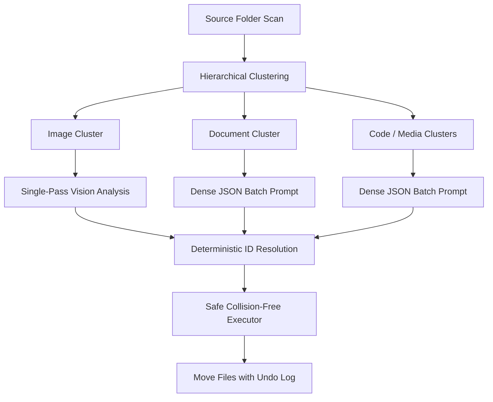

# NoMoreClutter 🗂️✨

An intelligent AI-powered desktop application that automatically organizes your files using Large Language Models (LLMs). Say goodbye to cluttered folders and let AI analyze, categorize, and rename your files with smart descriptive names!


---

## 🎯 Features

### 🚀 1-Click AI Quick-Deploy (Automated Model Setup)
- **📦 Built-In Embedded Local AI**: Single-click streaming download of compact, quantized GGUF models (`Qwen 2.5 1.5B`, `Qwen 2.5 0.5B`, `SmolLM2 1.7B`) from HuggingFace with live progress tracking and atomic file caching. Runs 100% offline in-process without needing LM Studio, Ollama, or API keys.
- **🦙 1-Click Ollama Auto-Pilot**: Automatically connects to your local Ollama daemon on `localhost:11434`, checks installed models, and pulls recommended models (`llama3.2:1b`, `qwen2.5:1.5b`, `moondream:latest`) with live progress streaming inside the UI.
- **⚡ 1-Click Free Cloud Connect**: Direct key generator links and instant connection verification for Groq and Google Gemini free tiers.

### ⚡ Zero-Install Cloud AI & Local Servers
- **Zero-Friction Cloud Access**: Use ultra-fast free-tier providers (**Groq**, **Google Gemini**, **OpenAI**, **OpenRouter**) with zero desktop software installation required.
- **Local Server Freedom**: 100% offline local AI support for **LM Studio** and **Ollama** whenever you want total privacy and self-hosting.
- **⚡ Quick Organize (No AI)**: One-click instant heuristic organization based on file extensions and metadata without requiring an LLM or network connection.

### 🧠 Recursive Language Model (RLM) Organization
- **Hierarchical Decomposition**: Files are grouped into logical clusters before prompting, preventing token exhaustion and staying well within free-tier rate limits (TPM/RPM).
- **📄 Intelligent Document Content Peeking**: Extracts compact, token-budgeted text snippets ($\le 200$ chars) from PDF documents, Word files (`.docx`), Markdown, and code/text files with zero third-party dependencies. Enables the AI to accurately classify invoices, meeting notes, and contracts even when filenames are cryptic (e.g., `Scan_001.pdf`).
- **📷 Camera Photo Date-Grouping & Anti-Hallucination Guard**: Camera photos with numeric timestamps (e.g., `20170926_112101.jpg`, `IMG_20180401...`) are automatically organized into chronological albums (e.g., `Photos/2017/`) without hallucinating arbitrary scenes (like labeling all files "Animals") when Vision is not active.
- **Token Frugality (~70% Savings)**: Ultra-dense JSON payloads eliminate repetitive path dumps and reduce prompt token overhead.
- **Single-Pass Vision Analysis & Text Fallback**: Categorizes and renames images in a single call when using vision-capable models (e.g. Groq Llama-Vision, Google Gemini). Automatically checks provider capabilities (`has_vision`) and gracefully routes images into text RLM and chronological date albums (`Photos/YYYY/`) on text-only models (like in-process Embedded GGUF), completely eliminating terminal errors and folder dumping.

### 🗂️ Interactive Tree Preview & Per-File Checkboxes
- **Hierarchical Visualizer**: Replaces blind all-or-nothing moves with an expandable, interactive Tree Preview window (`TreePreviewDialog`).
- **Selective Move Execution**: Files are grouped by destination subfolders (`Photos/2018`, `Invoices`). Toggle individual files or entire folders with `[☑ Select All]` to skip files you don't want moved.
- **Live Search & Direct File Inspection**: Instant search bar auto-expands and filters matching files. Double-click any row or click `👁️ Open` to inspect the original file before moving.

### 🔍 Smart Duplicate File Finder & Storage Reclaimer
- **Real-Time Progressive Streaming & Zero-Freeze UI**: Confirmed duplicate clusters are streamed and rendered in real time into the UI as files are hashed. The window remains fluid and responsive with live updating reclaimable space counters, completely eliminating post-scan freezing.
- **Zero-Dependency $O(N)$ Two-Stage Hashing**: Fast file size indexing ($O(1)$ disk reads) followed by 8KB header checks and 64KB chunked full SHA-256 for identical byte-for-byte matching.
- **Storage Metrics & Cluster Cards**: Displays total reclaimable space (e.g., `💾 Reclaimable: 1.45 GB`) and visual clusters marking the canonical 🟢 `ORIGINAL` alongside 🔴 `DUPLICATES`.
- **1-Click Safety Actions**: Move duplicates safely into `_Duplicates/` with collision-safe names (`file (1).ext`) or permanently trash selected duplicates.

### 🧹 Orphan Folder & Junk Pruner (One-Click Deep Clean)
- **Bottom-Up Leaf Pruning**: Recursively prunes abandoned empty directory branches from deepest leaves upward using safe `os.rmdir()` (which never deletes non-empty folders).
- **Zero-Byte File Clean**: Eliminates 0-byte leftover files and incomplete downloads.
- **OS Debris Removal**: Purges annoying Windows and macOS artifacts (`Thumbs.db`, `.DS_Store`, `desktop.ini`, `ehthumbs.db`, `.Spotlight-V100`).

### 🛡️ File Safety & ↩ Persistent Multi-Session Undo
- **Collision Avoidance**: Never overwrites existing files; intelligently renames colliding filenames to `name (1).ext`.
- **Persistent Multi-Session Undo**: Operation history is atomically committed to `history.json`. Revert past reorganization batches across app restarts and reboots with a single click of the `↩ Undo Moves` button.
- **Clean Destination Folders**: Rolling back automatically prunes newly created empty destination directories.
- **Non-Destructive Operations**: Files are safely moved with zero data loss risk.

### 🎨 Modern Dark UI & 🖥️ Spacious Two-Column Dashboard
- **Full-Screen Master-Detail Experience**: Automatically launches in full-screen maximized mode (`1340x880` default minimum geometry) to eliminate visual clutter and provide an expansive command center.
- **Top Navigation Bar**: Unified header featuring brand identity, an interactive AI status pill (🟢 **AI Plugged** / 🔴 **AI Unplugged**), utility tools (`🔍 Duplicates`, `🧹 Clean Junk`), and quick navigation (`🚀 1-Click Deploy`, `⚙️ Settings`).
- **Left Control Deck**: Cleanly separated modular cards for Directory Configuration, 2-column File Types to Process with `All` / `None` quick toggles, and Organization Control Center buttons with real-time status indicators.
- **Right Activity Stream & Terminal**: Full-height, dedicated real-time activity stream and terminal with a `Clear Log` button and monospace font formatting for clear, readable logs.
- **⚡ Hardware Auto-Tuner & Continuous Performance Sliders**: Real-time interactive sliders with live value badges for **RLM Cluster Batch Size** (1–30), **Max File Limit** (0–250), **Document Peek Context Budget** (50–350 chars), and **Inter-Batch Pacing Delay** (0.0s–2.0s). The built-in benchmark measures PC latency (ms) and throughput (tokens/sec) and uses continuous mathematical formulas to calibrate all 4 sliders to the exact optimal points for your hardware.
- **Provider Quick-Switching**: Dropdown selector with pre-configured API URLs, recommended models, and direct links to get free API keys.
- **Configurable Peeking & Settings Persistence**: Toggle document peeking, customize scan filters, and save provider preferences automatically.

---

## 📜 Project Principles & Guidelines

This project adheres to strict architectural and workflow principles:
- **[PRINCIPLE-001: RLM Compatibility](GUIDELINES.md#principle-001-rlm-compatibility-recursive-language-model)**: Hierarchical recursive decomposition for complex directory structures.
- **[PRINCIPLE-002: Automatic Git Workflow](GUIDELINES.md#principle-002-automatic-git-workflow-commit--push)**: AI assistants automatically stage, commit, and push updates.
- **[PRINCIPLE-003: Modularity & Pluggable Architecture](GUIDELINES.md#principle-003-modularity--pluggable-architecture)**: Decoupled AI providers, engines, and UI layers.
- **[PRINCIPLE-004: Living Principles System & Auto-Sync](GUIDELINES.md#principle-004-living-principles-system-extensible-governance--auto-sync)**: Extensible guidelines with automated cross-AI synchronization.
- **[PRINCIPLE-005: AI Cold-Start Readiness & Living README Sync](GUIDELINES.md#principle-005-ai-cold-start-readiness--living-documentation-readme-sync)**: 100% self-describing repository for cold-starting AI agents; mandatory README synchronization after every change.
- **[PRINCIPLE-006: Pre-flight Impact & Quality Checklist](GUIDELINES.md#principle-006-pre-flight-impact--quality-checklist-cold-start-gate)**: Pre-flight checklist assessing motivation, benefits, risks/harm, and quality preservation.
- **[PRINCIPLE-007: Performance & Resource Optimization](GUIDELINES.md#principle-007-performance--resource-optimization-speed--lean-architecture)**: High-speed execution, non-blocking I/O, lean dependencies, and token frugality.
- **[PRINCIPLE-008: Zero-Friction Onboarding & Hybrid AI Access](GUIDELINES.md#principle-008-zero-friction-onboarding--hybrid-ai-access-one-click-start)**: One-click start without mandatory external software, while retaining full local server support.
- **[PRINCIPLE-009: Token Frugality & Lean Code Architecture](GUIDELINES.md#principle-009-token-frugality--lean-code-architecture-context-budgeting)**: Concise code, strict token budgeting, dense payload serialization, and RLM clustering.
- **[PRINCIPLE-010: AI Knowledge Base & Continuous Synchronization](GUIDELINES.md#principle-010-ai-knowledge-base--continuous-synchronization)**: Active codebase knowledge base in `knowledge/` auto-updated after every change via AST synchronization.
- **[PRINCIPLE-011: Automated Test Verification & Continuous Test Coverage](GUIDELINES.md#principle-011-automated-test-verification--continuous-test-coverage-regression-shield)**: Mandatory test-backed changes and 100% test suite verification before committing.
- **[PRINCIPLE-012: Crash Resilience, State Atomicity & Power-Loss Recovery](GUIDELINES.md#principle-012-crash-resilience-state-atomicity--power-loss-recovery-fail-safe-operations)**: Atomic configuration persistence, incremental transaction journaling (WAL), and startup self-healing against abrupt power loss.

> **Universal AI Support**: These guidelines are automatically synchronized across all AI coding assistants (`AGENTS.md`, `GUIDELINES.md`, `GEMINI.md`, `CLAUDE.md`, `.cursorrules`, `.agents/rules/principles.md`, and `.github/copilot-instructions.md`) via `scripts/sync_principles.py`. Full specification in [GUIDELINES.md](GUIDELINES.md) and [AGENTS.md](AGENTS.md).

---

## 🚀 Getting Started

### Prerequisites

- **Python 3.12 or higher**
- An active AI provider choice (or use **Quick Organize** without any AI):
  - **Groq (Recommended / Free & Fast)**: Get a free key at [console.groq.com](https://console.groq.com/keys)
  - **Google Gemini (Free tier)**: Get a key at [aistudio.google.com](https://aistudio.google.com/app/apikey)
  - **OpenAI / OpenRouter**: Any OpenAI-compatible endpoint
  - **LM Studio / Ollama**: For offline local inference

### Installation

```bash
# Clone the repository
git clone https://github.com/Aegean-E/NoMoreClutter.git
cd NoMoreClutter

# Install dependencies
pip install -r requirements.txt
```

### Running the App

```bash
python main.py
```

### Running Tests

```bash
python -m unittest discover tests
```

---

## ⚙️ Configuration & Providers

### Supported Providers

| Provider | Type | Default Model | Vision Model | URL / Endpoint | Setup Required |
|----------|------|---------------|--------------|----------------|----------------|
| **Groq** *(Recommended)* | Cloud (Zero-Install) | `llama-3.3-70b-versatile` | `llama-3.2-11b-vision-preview` | `https://api.groq.com/openai/v1` | Free API Key |
| **Built-In Embedded AI** | Embedded (100% Offline) | `qwen2.5-1.5b-instruct-q4_k_m.gguf` | `moondream2-text-model-f16.gguf` | `local://embedded` | 1-Click in-app download |
| **Google Gemini** | Cloud (Zero-Install) | `gemini-1.5-flash` | `gemini-1.5-flash` | `https://generativelanguage.googleapis.com/v1beta/openai/` | Free API Key |
| **OpenAI** | Cloud (Zero-Install) | `gpt-4o-mini` | `gpt-4o-mini` | `https://api.openai.com/v1` | API Key |
| **OpenRouter** | Cloud (Zero-Install) | `meta-llama/llama-3.3-70b-instruct` | `meta-llama/llama-3.2-11b-vision-instruct` | `https://openrouter.ai/api/v1` | API Key |
| **LM Studio** | Local Server | `llama3` | `qwen2.5-vl-7b` | `http://localhost:1234/v1` | Start server on port 1234 |
| **Ollama** | Local Server | `llama3.2:1b` | `moondream:latest` / `llama3.2-vision:latest` | `http://localhost:11434/v1` | 1-Click auto-pull or `ollama serve` |
| **Custom** | Any | Custom | Custom | User-defined | Varies |

### Step-by-Step Usage

1. **Select Source Directory**: Click **Browse** and choose the messy folder you want to organize.
2. **Choose Organization Mode & Deploy AI**:
   - **🚀 1-Click AI Quick-Deploy**: Click the orange header button to open the deployment center with explicit **`[👁️ Vision Supported]`** and **`[📝 Text-Only]`** capability badges on every model:
     - **Tab 1: Built-In Embedded AI**: 1-click download compact offline GGUFs (including **Moondream 2 Multimodal Vision** with dual-file streaming for base model + `mmproj` vision projector).
     - **Tab 2: Ollama Auto-Pilot**: 1-click discover local Ollama server and pull recommended text or vision models (`moondream`, `llama3.2-vision`).
     - **Tab 3: Instant Free Cloud**: Instant setup with free-tier Groq or Google Gemini for instant vision intelligence with 0 MB disk footprint.
   - **⚡ Quick Organize (No AI)**: Immediately sorts files by type and extension without calling an LLM.
   - **🚀 Organize with AI**: Select your active provider, and click **🚀 Organize Files**.
3. **Inspect Progress**: Watch real-time logs in the bottom console area.
4. **Undo If Needed**: Click **↩ Undo Moves** at any time to reverse the previous batch of moves.

---

## 📁 Project Structure

```
NoMoreClutter/
├── main.py                     # Main application UI and orchestration (CustomTkinter)
├── knowledge/                  # AI Codebase Knowledge Base (PRINCIPLE-010)
│   ├── INDEX.md               # Master AI catalog and system map
│   ├── architecture.md        # Deep architectural layers and data flows
│   ├── services.md            # Service contracts, methods, and behaviors
│   ├── data_models.md         # Data models, schemas, and token formats
│   ├── state_and_ui.md        # UI hierarchy, concurrency, and threading
│   ├── decisions.md           # Architecture Decision Records (ADRs)
│   └── codebase_map.md        # AST-generated module & symbol registry
├── models/
│   ├── __init__.py            # Data models (FileInfo, FileCategory, ScanResult)
│   └── weights/               # Local GGUF model weights cache (auto-created, gitignored)
├── services/
│   ├── __init__.py            # Service factories & lazy loaders
│   ├── benchmark_service.py   # Automated hardware latency benchmark & settings auto-tuner
│   ├── file_scanner.py        # File discovery and extension filtering
│   ├── document_peeker.py     # Zero-dependency document content snippet extractor (PDF, DOCX, text)
│   ├── rlm_organizer.py       # RLM hierarchical categorization & token optimizer
│   ├── model_downloader.py    # 1-Click HuggingFace model weight streaming & verification
│   ├── ollama_manager.py      # 1-Click Ollama API discovery & streaming pull
│   ├── llm_service.py         # AI facade delegating to RLM and Providers
│   ├── file_executor.py       # Collision-safe execution & persistent multi-session undo history
│   └── providers/             # Pluggable AI provider system
│       ├── __init__.py        # Provider package exports
│       ├── base.py            # BaseAIProvider abstract interface
│       ├── embedded.py        # In-process GGUF inference provider
│       ├── registry.py        # Provider presets (Groq, Embedded, Gemini, OpenAI, Ollama)
│       └── openai_compatible.py # Standard OpenAI-compatible HTTP client
├── tests/                     # Automated unit test suite (PRINCIPLE-011)
│   ├── test_ai_status.py      # AI plugged/unplugged indicator & health check tests
│   ├── test_benchmark_service.py # Benchmark latency, vision probing & photo guard tests
│   ├── test_settings_functionality.py # Comprehensive settings function & persistence tests
│   ├── test_providers.py      # Provider registry & creation tests
│   ├── test_deploy_manager.py # Model downloader, Ollama manager & embedded provider tests
│   ├── test_document_peeker.py # PDF, DOCX, and text snippet extraction tests
│   ├── test_rlm_organizer.py  # RLM engine & token payload tests
│   ├── test_file_executor.py  # Safe move, collision avoidance, and persistent undo tests
│   ├── test_file_scanner.py   # Shallow/recursive scan & extension filter tests
│   ├── test_llm_service.py    # LLMService facade & error wrapping tests
│   └── test_sync_and_knowledge.py # Principle parsing & AST symbol extraction tests
├── scripts/
│   ├── sync_principles.py     # Cross-AI guidelines synchronizer (PRINCIPLE-004)
│   └── update_knowledge_base.py # AST-based knowledge base auto-updater (PRINCIPLE-010)
├── settings.json              # Saved user preferences (auto-created, gitignored)
├── requirements.txt           # Python dependencies
├── AGENTS.md                  # Master AI guidelines and principles
├── GUIDELINES.md              # Human-readable architectural guide
└── README.md                  # Cold-start documentation
```

---

## 🧠 AI Codebase Knowledge Base

The repository includes a dedicated, modular knowledge base in [`knowledge/`](knowledge/INDEX.md) designed for AI assistants and contributors:
- **[Catalog & Sitemap](knowledge/INDEX.md)**: Overview, fast index, and onboarding map.
- **[System Architecture](knowledge/architecture.md)**: Layers, data flow diagrams, and component boundaries.
- **[Services Reference](knowledge/services.md)**: Detailed contracts and methods for RLM, providers, and executor.
- **[Data Models & Schemas](knowledge/data_models.md)**: Enums, dataclasses, dense JSON schemas, and payload examples.
- **[UI Concurrency & State](knowledge/state_and_ui.md)**: CustomTkinter threading, safe worker dispatch, and settings.
- **[Architecture Decision Records](knowledge/decisions.md)**: Context, decisions, and trade-offs for RLM, hybrid AI, and undo history.
- **[Auto-Generated Codebase Map](knowledge/codebase_map.md)**: Complete AST breakdown of all modules, classes, and function signatures.

Run `python scripts/update_knowledge_base.py` at any time to verify and synchronize the knowledge base with the latest code state.

---

## 🔧 Architecture: Recursive Language Model (RLM)

Instead of dumping hundreds of raw file paths into a single LLM prompt (which blows up context windows and hits rate limits), NoMoreClutter uses a **Recursive Language Model** architecture:



1. **Hierarchical Clustering**: Files are partitioned by semantic domain and extension type.
2. **Dense Token Serialization**: Payloads use compact relative identifiers (`{"id": 0, "name": "...", "ext": "..."}`) cutting token costs by ~70%.
3. **Deterministic ID Resolution**: LLM responses are indexed by exact IDs, eliminating off-by-one mapping errors.
4. **Collision-Safe Execution**: Every move verifies destination paths and appends numbered suffixes (`file (1).ext`) if collisions exist.
5. **Undo Log**: Every executed operation is preserved in an in-memory stack, allowing instant rollback.

---

## 🐛 Troubleshooting

### "Failed to connect to AI"
- **For Cloud Providers (Groq, Gemini, OpenAI)**: Make sure your API key is correctly pasted in the settings panel and you have an active internet connection.
- **For Local Servers (LM Studio, Ollama)**: Ensure your server is running and listening on the designated port (`1234` for LM Studio, `11434` for Ollama).

### "No files found"
- Ensure you picked a directory with files matching the selected category checkboxes.
- If organizing subdirectories, ensure files are in the scanned depth.

### "Reverting file moves"
- Simply click **↩ Undo Moves** in the UI. The app will move all files from the last executed batch back to their exact original locations.

---

## 🤝 Contributing

Contributions are welcome! Please ensure:
1. All changes respect the 9 core principles in [GUIDELINES.md](GUIDELINES.md) and [AGENTS.md](AGENTS.md).
2. Existing unit tests pass: `python -m unittest discover tests`.
3. Principles are kept synchronized using `python scripts/sync_principles.py`.

---

## 📝 License

MIT License - Feel free to use and modify as needed!

---

Made with ❤️ for cleaner directories everywhere
